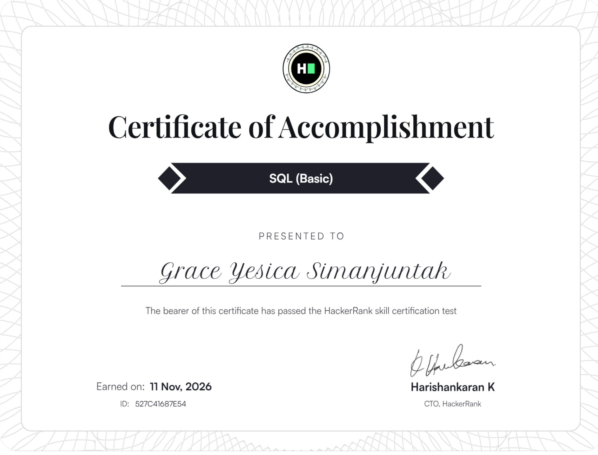

# Hi, I'm Grace Yesica Simanjuntak! 👋

<p align="left">
  
</p>

### 🎓 Computer Engineering Student | Aspiring Software Developer

I'm a Diploma III Computer Technology student at **Institut Teknologi Del**, Indonesia. I am passionate about software engineering, Internet of Things (IoT), and backend development. I thrive on building practical solutions, exploring modern technologies, and collaborating in team-driven environments.

---

## 📜 Licenses & Certifications

<table>
  <!-- Baris 1: Software Engineer Intern & Problem Solving -->
  <tr>
    <td width="50%" align="center">
      <a href="https://www.hackerrank.com/certificates/CFB1B263D3F5" target="_blank">
        
      </a>
      <br><br>
      <b>Software Engineer Intern</b>
      <br>
      <a href="https://www.hackerrank.com/certificates/CFB1B263D3F5" target="_blank">
        
      </a>
    </td>
    <td width="50%" align="center">
      <a href="https://www.hackerrank.com/certificates/7115F06CF889" target="_blank">
        
      </a>
      <br><br>
      <b>Problem Solving (Intermediate)</b>
      <br>
      <a href="https://www.hackerrank.com/certificates/7115F06CF889" target="_blank">
        
      </a>
    </td>
  </tr>

  <!-- Baris 2: Python (Basic) & SQL (Basic) -->
  <tr>
    <td width="50%" align="center">
      <a href="https://www.hackerrank.com/certificates/AF25CD258C5D" target="_blank">
        
      </a>
      <br><br>
      <b>Python (Basic)</b>
      <br>
      <a href="https://www.hackerrank.com/certificates/AF25CD258C5D" target="_blank">
        
      </a>
    </td>
    <td width="50%" align="center">
      <a href="https://www.hackerrank.com/certificates/527C41687E54" target="_blank">
        
      </a>
      <br><br>
      <b>SQL (Basic)</b>
      <br>
      <a href="https://www.hackerrank.com/certificates/527C41687E54" target="_blank">
        
      </a>
    </td>
  </tr>

  <!-- Baris 3: Go (Basic) & Rest API (Intermediate) -->
  <tr>
    <td width="50%" align="center">
      <a href="#" target="_blank">
        
      </a>
      <br><br>
      <b>Go (Basic)</b>
      <br>
      <a href="#" target="_blank">
        
      </a>
    </td>
    <td width="50%" align="center">
      <a href="#" target="_blank">
        
      </a>
      <br><br>
      <b>REST API (Intermediate)</b>
      <br>
      <a href="#" target="_blank">
        
      </a>
    </td>
  </tr>
</table>

---

## 🛠️ Technical Skills

<details open>
<summary><b>Languages & Frameworks</b></summary>
<br>


</details>

<details open>
<summary><b>Databases & Hardware (IoT)</b></summary>
<br>


</details>

<details open>
<summary><b>Tools & Platforms</b></summary>
<br>


</details>

---

## 📂 Featured Projects

### 🌾 [IoT Soil Nutrient Monitoring System](https://github.com/graceyesica/perangkat-pengukur-unsur-hara-tanah-portabel)
> *Role: Project Leader*
- An IoT-based device designed to measure soil nutrients, monitor data in real-time, and provide AI-based crop planting recommendations.
- **Tech Stack:** ESP32, Modbus RS485, IoT Sensors.

### 🌐 [UMKM Website – Toba and Samosir](https://github.com/graceyesica/website-informasi-umkm-toba-samosir)
> *Role: Project Leader*
- A centralized web-based platform dedicated to promoting local MSMEs, restaurants, and native crafts across Toba and Samosir.
- **Tech Stack:** Web Development, Waterfall Methodology.

### 💨 An Internet of Things (IoT)-Based Soil Nutrient Measurement System and Generative Artificial Intelligence (AI)-Based Analysis
- An automated temperature-responsive fan system activated using ambient heat monitoring and human presence sensing.
- **Tech Stack:** ESP32, Sensors, Embedded C/C++.

### 🏫 [CampusConnect+ (Distributed System Project)](https://github.com/graceyesica/CampusConnect-)
> *Role: Backend & Distributed Systems Developer*
- A distributed digital platform for campus activities and facility reservations. Built with a **Microservices Architecture**, it utilizes independent services (User, Event, Booking, Notification) communicating via REST API.
- Implements **MongoDB Replica Set (3 nodes)** to ensure high availability, data replication, and automatic failover, simulated using VMware.
- **Tech Stack:** Node.js, Microservices, REST API, MongoDB, VMware.

### ☀️ [Smart Solar Panel Miniature with Sun Tracker & Auto Wiper] 
> *Role: Project Team Member*
- An IoT-based smart solar panel prototype equipped with an automated sun tracking system to maximize solar energy absorption and an automatic wiper mechanism for self-cleaning.
- **Tech Stack:** IoT, Sensors, Microcontrollers, Hardware Prototyping.

---

## 🚀 Leadership & Organizational Experience

- **Secretary** – *HIMATEK (Computer Technology Student Association)* `2024 – Present`
  - Led administrative documentation, coordinated member records, and assisted overall program scheduling.
- **Project Leader** – Guided software and IoT student development teams from ideation to delivery.

---

## 🎓 Education

- **Diploma III in Computer Technology** | *Institut Teknologi Del* `2024 – 2027 (Expected)`
  - Active focus: Embedded Systems, Computer Networking, Software Development.

---

## 🌱 Currently Exploring

```text
Backend Architectures  •  RESTful API Design  •  IoT System Integration  •  Database Optimization
